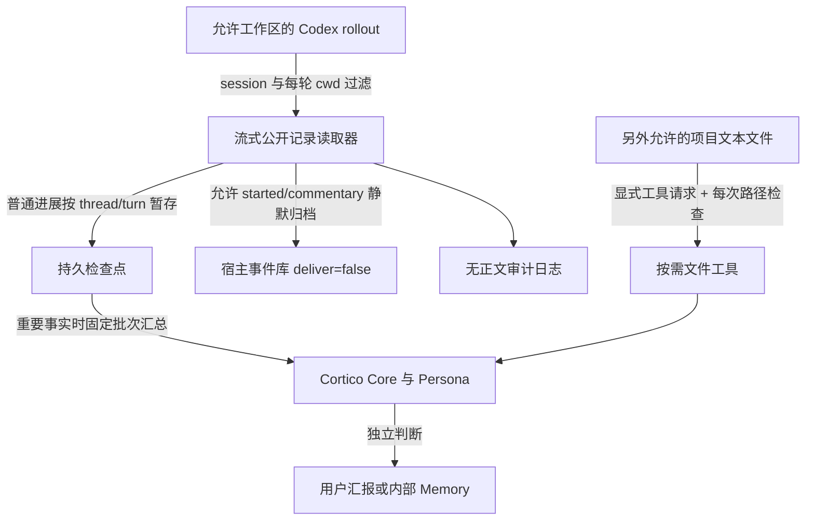
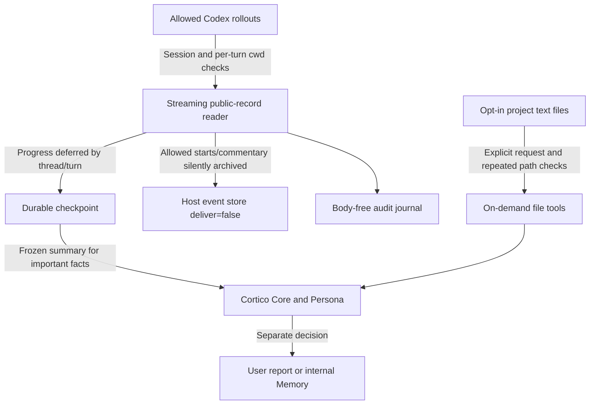

Owner: `src/world.ts` / `CodexBridgeWorld`; `src/reader.ts` / `CodexRolloutReader`; `src/workspace.ts` / `WorkspaceFiles`.

# 🚨 安全风险 / SECURITY RISKS — 启用前必读 / READ BEFORE ENABLING

**这会把允许工作区内的 Codex 聊天，以及你另外开启的项目文件，暴露给 Cortico 智能体。它们可能进入宿主事件库、模型请求、回答和下游消息。请用具体项目根；项目文件功能默认关闭。不要因为“本机读取”“源只读”或“有脱敏”就认为内容不会离开电脑。**

**This can expose allowed Codex conversations and optionally enabled project files to the Cortico agent. Content may enter the host event store, model requests, replies and downstream messages. Authorize specific project roots. Project-file access defaults to off. Local, read-only and redacted do not mean local-only or confidential.**

| 风险 / Risk | 影响与边界 / Consequence and boundary |
| --- | --- |
| 聊天和项目文件外泄 / Conversation and file disclosure | 代码、业务资料、路径和个人内容仍可能送到模型或用户；只授权审阅过的项目，检查模型提供商与回复收件范围。/ Code, business data, paths and personal information can reach models or recipients; review scopes, providers and recipient rules. |
| 提示注入 / Prompt injection | 聊天、README、源码注释和配置正文都可能含诱导执行的指令。导入材料是外部证据，不能授予工具或反向控制权限。/ Chats, READMEs, comments and configuration can contain hostile instructions. Imported material is evidence, not authority to execute or control. |
| 脱敏不完整 / Incomplete scrubbing | 已知凭据形状会清洗；未知密钥、姓名和商业信息未必能识别，清洗也可能改变代码和证据。/ Known credential shapes are scrubbed; unknown secrets and private information may remain, while redaction can alter evidence. |
| 文件访问扩大范围 / Broader file exposure | 开启后会读取允许根中的文本项目资料，独立于聊天收录。过滤规则会排除许多敏感/机器文件，但不是内容保密证明。/ File access adds text resources beyond chat intake. Filters exclude many sensitive/machine files but do not prove confidentiality. |
| 当前文件与历史不同 / Current files versus history | 文件工具读当前磁盘，不能当聊天当时的代码快照；结合版本/时间解释历史。/ File tools read current disk content, not code at conversation time; compare versions/times before drawing historical conclusions. |
| 路径竞争 / Path races | 标准 Node 路径和文件身份检查不是操作系统能力级原子沙箱；恶意并发目录交换不能宣称完全防住。只选择自己控制的可信项目目录。/ Standard Node path/identity checks are not an OS capability sandbox; do not claim resistance to malicious concurrent directory swaps. Use trusted directories you control. |
| 非稳定源格式 / Unstable source format | legacy rollout JSONL 是本机兼容适配器，不是官方长期稳定承诺。升级后须重新验收，空结果不能当完整历史结论。/ Legacy JSONL is a local adapter without a stable official contract; revalidate upgrades and do not interpret empty results as full coverage. |
| 资源和费用 / Resources and cost | 大行、历史前缀重放、归档、查询及重要通知消耗 I/O、磁盘和模型 token。目标扫描预算不是全部 I/O 的硬上限。/ Large lines, prefix replay, archives, queries and notifications consume I/O, storage and model tokens; target budgets are not total-I/O hard caps. |
| 检查点与重复 / State and duplicates | 检查点丢失或错误重置会破坏来源锚点和投递对账；宿主事件保存不等于用户已收到消息。/ Losing or resetting state damages identity anchors and receipt reconciliation; host storage does not prove user delivery. |

**源文件只读，桥接仍写自己的检查点、元数据日志和宿主归档。检查点可能包含有界公开进展，宿主事件可包含正文。不要上传运行目录、真实项目文件、聊天、`.env`、登录资料、部署配置、token 或恢复备份。**

**Source files remain read-only, but the bridge writes checkpoints, metadata journals and host archives. Checkpoints can contain bounded public progress, and events can contain text. Never publish runtime state, actual project files, conversations, `.env`, login material, deployment settings, tokens or recovery backups.**

# Cortico Codex Bridge World 0.2.0

独立仓外 World，id `codexbridge`，配置段 `worlds.codexbridge`，控制台页面 `world:codexbridge`。读取工作区受限的 Codex 公开聊天和明确任务状态；另外提供默认关闭的**按需项目文件读取**。反向任务控制属于另一包，需要独立授权，不由本包提供。

An independent external World: id `codexbridge`, configuration `worlds.codexbridge`, console page `world:codexbridge`. It reads scoped public Codex conversations and explicit task states, with **opt-in on-demand project-file reading**. Reverse task control belongs to another package with separate authorization.

**发布状态 / Release status:** 发布说明已交付，用户已授权 GitHub 上传。本项目独立仓外交付；包保持 `private:true`，通过仓库源码或 `.tgz` 安装，未发布到 npm。测试、契约、生产挂载和 24 小时稳定性各自验收；本版本尚未完成生产挂载或 24 小时稳定性验收。/ The manual has been delivered and the user has authorized GitHub upload. This is an independent external World, installed from repository source or a `.tgz`; `private:true` prevents accidental npm publication. Tests, contract validation, production mounting and 24-hour stability are separate acceptance layers. This version has not yet completed production mounting or 24-hour stability acceptance.

[完整中文说明](#中文说明) · [Complete English manual](#english-manual)

## 中文说明

### 1. 要求和功能边界

需要 **Cortico World API 5**。开发 SDK 使用 Cortico 0.1.7，当前现场验证宿主基线也是 0.1.7；宿主会检查实际契约，不保证未来 API 变化自动兼容。本仓开发工具要求 **Node.js 22.15.0 或更高的兼容版本**。先核对 Node 与宿主运行要求，再安装。

来源是 `sessionsDir` 中的本机 `codex-rollout-v1` legacy JSONL。保留公开 user、assistant commentary/final_answer，以及明确结构化状态/需要用户/额度信号。普通机器注入、内部 reasoning、图片、一般工具调用/输出和事件正文副本被过滤。来源格式可能变化，不保证完整复刻 Codex UI。

sessionsDir未显式配置时，默认是当前进程用户的 `~/.codex/sessions`；配置要求实际绝对路径，不能把空字符串作为已配置源。默认stateDir空表示宿主部署data/codexbridge。确认进程用户和实际文件来源，避免读错另一个账户的会话。

默认不回灌首次启动已有历史；建立当前基线，之后读取新增内容。已有检查点则接续原游标和未确认投递；新发现线程按完整记录处理。查询工具可按允许范围读历史；自动通知策略与按需查询是不同路径。

项目文件功能只按工具请求读取/列目录/字面搜索，不写文件、不执行代码、不每 5 秒扫描全部仓库，也不自动把项目文件导入 Memory。Cortico Persona 对结果的使用、内部 Memory 写入及用户汇报仍独立决定。

Windows 是当前现场验证平台。Unix 示例说明路径语法，未表示本次现场验证已经覆盖 Linux/macOS。原生 Codex 文件版本、宿主契约和目标平台应分别验收。

### 2. 工作原理



每批通知先持久保存固定源字节范围、条目 ID 和 delivery ID，再保存宿主事件，最后推进游标。检查点采用临时文件原子替换；中断重试通过固定 marker 在宿主事件库对账，后来追加内容不能改变已冻结批次。

来源截断、替换、消失、坏完整行或检查点不兼容都会报错并保留旧游标，不能自动改认另一文件。0.1.5 以来，重复 UUID 只有恰好一个候选与检查点原生 identity 匹配才续读；其他副本隔离并提示。无锚点、原源缺失或多个匹配仍拒绝，不按文件大小、修改时间或名字选源。

### 3. 安装和第一次验证

1. 下载审阅通过的源码或克隆审阅过的版本。开发验证在本仓根运行：

   ```bash
   npm ci
   npm test
   npm run typecheck
   ```

2. 在 Cortico“扩展 → World”选择本仓克隆根目录（包含 `package.json`、`src/` 和 `console.js`）。本机目录以链接安装，后续改目录中代码可能改变重载行为；把审阅副本放固定位置。
3. 命令行替代方式，模板中路径全部替换为实际绝对路径：

   ```bash
   cd <CORTICO_ROOT>/extensions
   corepack pnpm add --ignore-workspace "<ABSOLUTE_CODEX_BRIDGE_REPO>"
   ```

   宿主设置 `CORTICO_EXTENSIONS_DIR` 时改用该目录。`--ignore-workspace` 防止部署扩展被写进主仓工作区依赖。
4. 在 Cortico 根可运行：

   ```bash
   corepack pnpm check:extension "<ABSOLUTE_CODEX_BRIDGE_REPO>"
   ```

   契约检查不调用真实 `start()`，不能替代现场读取验收。
5. 保持 World 停用，先填写具体工作区、拒绝路径和独立状态目录，项目文件功能保持关闭。核对后正常启用/重载，检查工作台范围、最近成功、当前错误、覆盖告警，再做一次范围内的 list/read。

配置字段均非热更新；保存后通过宿主正常生命周期重新加载。`npm pack` 打出的独立 tarball 仅含包声明、源码、面板、元数据审计脚本、README、LICENSE 和 NOTICE，不含测试、依赖或运行资料，可作为本机安装归档。打包不会自动发布或启用；`private:true` 防意外 npm publish。

### 4. 最小配置与监听范围

这是合并到现有部署的配置片段，不能直接替换整个配置。示例目录与项目需换成自己的已审阅路径。第一次 `enabled:false`，确认后再开。

```json
{
  "worlds": {
    "codexbridge": {
      "enabled": false,
      "sessionsDir": "C:/BridgeSources/codex-sessions",
      "allowedWorkspaces": "[\"C:/Projects/bridge-demo\"]",
      "deniedWorkspaces": "[\"C:/Projects/bridge-demo/private\"]",
      "includeSubagents": false,
      "notificationPolicy": "important",
      "watchIntervalSeconds": 5,
      "notifyPhases": "commentary,final_answer",
      "notifyUserMessages": true,
      "notifyLifecycle": true,
      "eventContentChars": 400,
      "workspaceFilesEnabled": false,
      "workspaceFileRoots": "[\"C:/Projects/bridge-demo\"]",
      "workspaceMaxFileBytes": 1048576,
      "stateDir": "C:/BridgeState/codexbridge"
    }
  }
}
```

`allowedWorkspaces`、`deniedWorkspaces` 是**包含绝对路径 JSON 数组的字符串**，不是逗号列表或 glob。至少一个允许路径，最多 100 项；根包含子目录，拒绝优先。配置检查规范化真实路径；session header 和每个 turn cwd 均需符合范围，原生线程初始位置不会授权后续越界回合。

读取源文件只能在真实 `sessionsDir` 中；源符号链接和越界路径拒绝。拒绝规则还检查路径名，不能靠别名让拒绝路径变允许。默认 `includeSubagents:false` 排除明确原生子代理/派生任务；开启会扩大来源与复制历史语义，需要另行评估。没有通用“私密目录自动识别”；自己维护 deny 列表。

Unix 语法示例，未在本次 Windows 现场验收：

```json
{
"sessionsDir": "/home/example/.codex/sessions",
"allowedWorkspaces": "[\"/srv/projects/bridge-demo\"]",
"deniedWorkspaces": "[\"/srv/projects/bridge-demo/private\"]",
"stateDir": "/var/lib/cortico-bridges/codexbridge"
}
```

状态目录必须独立于源会话、拒绝路径与其相关边界。桥接需要写自身状态，不应获得写源聊天的权限。

### 5. 项目文件：必须另外开启

`workspaceFilesEnabled` 默认 `false`。**文件允许根独立使用 `workspaceFileRoots`**，绝对路径 JSON 数组字符串，默认 `[]`，开启时必须非空。每个文件根必须在聊天 `allowedWorkspaces` 之内，`deniedWorkspaces` 仍优先；文件根只能收窄授权。已有较宽聊天范围可保留，再给文件工具设置具体小项目根，无需为了开文件重置历史检查点。文件根配置不参与聊天 scopeHash；真正改聊天 allow/deny 时仍按状态迁移流程处理。

文件根拒绝盘符/文件系统根、HOME 或它的宽泛祖先、隐藏/缓存/会话等受限路径；目录必须存在。不建议用整个用户目录、盘符或资料总目录。关闭再重载文件功能会释放进程内目录游标。

有效文件deny除了deniedWorkspaces，还包含源sessionsDir和桥接stateDir，避免将自定义改名的源或检查点当项目资料读出。

启用顺序：先在workspaceFileRoots填具体项目并核对deny；把workspaceFilesEnabled改true，保存并正常重载；先list该根的`.`，再read一个公开README，确认来源、过滤和分页后才做search。不需要时改false并重载；它撤销后续工具能力，不撤回过去已读资料。文件是当前磁盘状态，与聊天当时版本可能不同。

`workspaceMaxFileBytes` 默认 1 MiB（1,048,576），配置最大 8 MiB（8,388,608）；这是单文件可读上限，不是无限文本读取。读取和搜索还受批次输出/扫描预算与分页限制。默认过滤凭据、隐藏目录、`.git`、依赖、构建、二进制、数据库、日志、归档和私钥形状；**仍可能读出以普通名称存放的敏感文本**。

只有文本文件allowlist和有效UTF-8内容；含NUL、非法UTF-8或识别出的私钥正文拒绝。并非任意扩展名文件都可以“当文本试读”。

三个工具共用精确 `root` 与根内相对 `path`。root 必须是 `workspaceFileRoots` 中的一个根，不接受临时任意目录；path 不可绝对、不可 `..` 越界，拒绝设备名/ADS和含糊路径。每次请求重新检查逻辑/真实路径、deny与文件身份，拒绝symlink、junction和hardlink，根目录被替换报 `SOURCE_CHANGED`。这些标准Node前后检查不是原子安全沙箱：选择自己控制的可信目录，不让不可信进程同时交换目录。结果清洗已知凭据形状，不执行内容。

| 工具 | 示例与分页 |
| --- | --- |
| `codexbridge_files_list` | `{"root":"C:/Projects/bridge-demo","path":".","limit":20}`；列该目录直接子项（非递归），用返回 `nextCursor` 作为下次 `cursor`。 |
| `codexbridge_file_read` | `{"root":"C:/Projects/bridge-demo","path":"README.md","offset":0,"maxChars":12000}`；用 `nextOffset` 续读，offset是**脱敏后文本的UTF-16字符位置**；`version` 是原文件SHA256，多页应核对版本一致。 |
| `codexbridge_files_search` | `{"root":"C:/Projects/bridge-demo","path":".","query":"initialize","limit":20}`；在该目录递归做区分大小写字面搜索，每个匹配文件返回首个命中的节选；用 `nextCursor` 继续。 |

未知参数拒绝。list/search cursor是**进程内实时遍历令牌**，5分钟有效、单次消费、最多16个活动令牌；过期、重复使用、重启/停用后重新从原请求开始，不当永久偏移或快照。read每页重新读取有界文件并计算version；版本变了就停止拼接，重新读取，不能把不同版本页合成证据。

固定边界：每页最多检查512个目录项；list最多100条；search每页最多32个文件或8MiB实际读取、最多20个命中；read最多32,000字符；待遍历目录最多1024，超过明确报告覆盖不足。输出 `truncated/incompleteReasons/skipped` 描述预算与遗漏，`coverage` 仅指合格文本allowlist。`SKIPPED/EXCLUDED` 和无命中都不证明完整仓库没有目标词。

这些工具不是反向控制，不提供修改、执行或工具授权。它们返回的 README/代码同样可能是提示注入；应当作为有来源的外部资料解释。发布源码时不能附带被允许项目的真实文件。

接口与边界实现可核查 [src/config.ts](src/config.ts)、[src/workspace.ts](src/workspace.ts)、[src/reader.ts](src/reader.ts) 和 [src/world.ts](src/world.ts)。

### 6. 会话工具和结果解释

| 工具 | 用法 |
| --- | --- |
| `codexbridge_list` | `limit/offset`；只列元数据、总数、来源与 `discoveryWarnings`。 |
| `codexbridge_read` | 完整 `threadId`，`offset` 用上一页 `nextOffset` **字节游标**；可选 `limit/maxChars`。 |
| `codexbridge_search` | 字面 `query`，可选 `threadId/limit/cursor`；使用返回的 `nextCursor` 继续。 |
| `codexbridge_status` | 查看运行、范围、游标、队列、暂存线路、最近成功与当前错误。 |

公开正文受字符上限约束；`truncated`、`incompleteReasons`、`discoveryWarnings`、半行及扫描预算说明覆盖不完整。搜索空结果不能证明全部历史不存在目标词。线程 ID 和游标必须来自对应结果，不允许模型任意源路径。

### 7. 通知与 token 消耗

默认 `notificationPolicy:important`：普通用户输入、started/commentary 按 thread/turn 暂存计数、源引用和有界最后公开进展；允许的 started/commentary 用 `deliver:false` 静默归档，不因该事件唤醒模型。

final_answer、原生 completed/failed/aborted、明确 request_user_input/审批/等待用户信号与结构化 quota/rate_limit/credits 错误才触发重要汇总。不按问号、任意工具或额度样式句子猜测重要性。同一工作段 final/completed 配对去重，新重要事实仍可通知。

无普通进展超时唤醒；未结束的工作段重启后继续暂存。`all` 是逐页立即通知兼容模式，会增加模型触发。`notifyPhases/notifyUserMessages/notifyLifecycle` 限定一般收录，重要结构化信号单独保留。5 秒检查是本地轮询频率；项目文件不自动随轮询读取。

通知正文每批最多 24,000 字符，活动/暂存路线最多 10,000 条；终态去重近期 128 段，活动暂存不裁掉。容量耗尽报错、保留游标，不能通过删检查点消除积压。Persona 决定是否回复用户、写内部 Memory；本包不直接向 QQ 发送。

### 8. 大记录、预算和状态

64 KiB 块验证完整 UTF-8 与 JSON 语法，投影保留公开正文和必要归属字段。图片、大工具输出等被过滤内容仍校验；合法大行不以旧 8 MiB 上限整体阻挡。必要归属/分类字段超过结构限制报 `PROJECTION_LIMIT`，保留原位置，不拿截断 cwd 或状态作为授权。

`maxReadBytes` 默认每页 2 MiB目标，`maxScanBytes` 默认每轮新区域 8 MiB目标。页首完整记录可原子超出目标，保证大行推进；超出后结束本页并按实际新区域字节扣减轮询预算。深分页为恢复 turn cwd 需要 O(offset) 历史前缀扫描，另记 `contextBytesScanned/contextScannedBytes`，不在新区域目标预算内。

观察 `bytesScanned/scannedBytes`、`budgetExceeded/budgetOverrunBytes` 与上下文成本；不能把配置当硬 I/O 上限。空闲仅检查元数据。坏完整行/非法 UTF-8 不推进，无 LF 半行等源追加。检查点来源 identity、scope hash 和固定投递 ID 帮助对账；更换来源与 scope 必须保留状态并明确迁移。

### 9. 监测与日志验收

页面独立显示当前错误、成功时间、游标、`behindThreads`、`pendingDeliveries`、覆盖告警与暂存线路。健康空闲、分批追赶、无生产通知样本、禁用和故障需区分；累计 failures 不清零，修复看新增失败与 currentError。

状态默认 `<deployment>/data/codexbridge`，含 checkpoint 和每日 audit JSONL。审计脚本检查桥接恢复文件与元数据日志，报告省略正文，不读取源聊天或项目文件。检查点仍可能含有界公开进展，不应公开。

```bash
npm run audit -- --data "<ABSOLUTE_DATA>/codexbridge" --hours 24 --out "<ABSOLUTE_PRIVATE_REPORTS>/codex-audit.json"
```

24 是请求窗口；新版实际挂载不足 24 小时需标观察不足。通过测试、干净日志、很多空闲心跳都不能单独宣称稳定通过。核对真实来源位置、增量、投递 ID/宿主回执、队列和覆盖告警；没有生产重要事件样本就写“该能力无样本”，不得虚构完成。

宿主保存通知不等于 QQ 已发；QQ 原生崩溃、OneBot 端口与账号是另外链路。

### 10. 出岔子如何修

| 问题 | 核查与处理 |
| --- | --- |
| 灯红/无新读 | 看 currentError、lastSuccess、实际版本与路径；保存状态，修正精确路径/权限后正常重载。 |
| 重复 UUID | 唯一 checkpoint identity 匹配可继续，其余副本隔离；无锚点/原源缺失/多匹配拒绝，不能按新旧/大小强选。 |
| 截断/替换/坏 JSON/UTF-8 | 保留游标与源证据，在副本验证兼容修复；不要手改源行或跳过。半行等完成。 |
| scope mismatch | 恢复旧配置对账未确认意图；明确迁移后使用独立新 state，不删旧文件、不手改 scopeHash。 |
| 文件工具不可用 | 确认显式开关、具体项目根、实际包版本；宽根/隐藏/敏感/超大文件拒绝是边界，不能以全盘或关过滤绕过。 |
| file/search 页缺结果 | 检查 path、deny、符号链接、文件大小、truncated 和下一页；预算内无命中不表示全仓无内容。 |
| 通知很多 | 看是否 all、重复部署或宿主其他触发；回到 important，核对 deliver:false，保留 pending。 |
| 只有进展无通知 | 默认预期暂存；按需查询，核对重要原生信号；缺终态不伪造完成。 |
| pending 投递不消失 | 用固定 delivery ID 对账宿主回执、状态可写性；恢复正常保存后续同 ID，不能删 pending 重发。 |
| 升包后仍旧 UI | 看实际包文件/加载版本与宿主启动；console.js 变更提高版本，正常重载并刷新。 |
| 宿主事件成功，QQ无消息 | Persona报告决策、原收件范围、QQ协议/端口/账号/回执分别检查，不能由读取灯判定QQ送达。 |

### 11. 停用、改范围和回滚

正常停 World、等待在途轮询与工具退出，备份包清单、配置、checkpoint 和日志。scope变化会拒绝不匹配原状态。先恢复原配置对账；需要新范围时明确归档旧状态、处理 pending/暂存后用独立状态建立新基线，不静默放弃旧积压。

回滚需旧版兼容当前 checkpoint；保留原 package/manifest。不能读新状态时停止并制定迁移，不能删状态重启。关闭文件功能撤销后续工具读取，但不会删除宿主既有事件、模型已接收资料或内部 Memory。

### 12. 开发、发布与问题报告

源码、测试、说明、锁文件和占位配置可发布；生产 data/部署/项目内容/日志/备份不能随包带入。运行 npm检查再由宿主执行契约检查，仍需独立现场验收。包使用 private:true；安装选本机目录，不以 npm公开包名宣称已发布。

issue提供版本、Node/宿主、开关、已脱离本机的范围形状、错误码与最小合成复现。真实路径、UUID也可能敏感，保持一致占位，勿贴正文或完整 checkpoint。主库接入 issue 描述外部扩展、安装、风险和契约证据，不意味着主库内置。用户审本 README 后再进行 GitHub 上传。

## English manual

### 1. Requirements and boundaries

The World requires **Cortico World API 5**. The development SDK and current live-validation host baseline are Cortico 0.1.7. The loader checks the actual contract; future API changes are not automatically supported. Repository development tooling requires **Node.js 22.15.0 or a newer compatible version**. Check host/runtime requirements before installation.

The adapter reads local legacy JSONL under `sessionsDir`, labelled `codex-rollout-v1`. It retains public user and assistant commentary/final_answer messages plus explicit structural lifecycle/user-action/quota signals. Machine injections, private reasoning, images, ordinary tool calls/outputs and event text copies are filtered. This source format can change and is not a complete Codex UI replica.

The default source is the current process user's ~/.codex/sessions. Configuration requires an actual absolute sessionsDir, not an empty string. Empty stateDir selects deployment data/codexbridge. Verify the process user and real source rather than reading another account accidentally.

First startup establishes the current baseline without sending all old history. Existing checkpoints continue original positions and pending deliveries; later newly discovered threads process complete records from their beginning. Historical queries and automatic notifications are different paths.

Optional files are listed/read/literally searched only on explicit tool requests. The feature does not modify or execute files, scan the whole repository every five seconds or automatically import files into Memory. Persona independently decides how results affect replies or internal Memory.

Windows is the current live-validation platform. Unix examples show syntax, not acceptance of Linux/macOS in this Windows run. Source format, host contract and platform require separate validation.

### 2. How it works



Before notifying, the bridge persists the fixed source byte range, item IDs and delivery ID. It then stores the host event and finally advances the cursor. Checkpoints use atomic temporary-file replacement. Retries reconcile the fixed marker in the host event store; later append data cannot change the frozen batch.

Truncated, replaced, missing or malformed sources and incompatible checkpoints fail without discarding old positions. Since 0.1.5, duplicate UUIDs resume only when exactly one allowed candidate matches the saved native identity. Other copies remain isolated with diagnostics. Missing anchors/originals or multiple matches remain rejected; size, modification time and filename are not identity selection rules.

### 3. Installation and first validation

1. Download reviewed source or clone the reviewed version. In the repository root:

   ```bash
   npm ci
   npm test
   npm run typecheck
   ```

2. Choose this cloned repository root (containing package.json, src/ and console.js) in Cortico **Extensions → World**. Local installation is linked, so later source edits affect reloading. Keep the reviewed copy in a fixed location.
3. Command-line alternative; replace all path placeholders:

   ```bash
   cd <CORTICO_ROOT>/extensions
   corepack pnpm add --ignore-workspace "<ABSOLUTE_CODEX_BRIDGE_REPO>"
   ```

   Use `CORTICO_EXTENSIONS_DIR` when the host sets it. `--ignore-workspace` keeps deployment dependencies out of the main workspace.
4. Optional host contract validation:

   ```bash
   corepack pnpm check:extension "<ABSOLUTE_CODEX_BRIDGE_REPO>"
   ```

   It does not start live sources or establish production acceptance.
5. Configure specific roots, exclusions and a separate state directory while disabled. Leave file access off. Enable/reload normally, check scope, recent success, errors and discovery warnings, then perform one scoped read.

Fields are not hot-reloadable. Apply changes through the host lifecycle. npm pack creates an independent tarball of the manifest, source, console, metadata audit script, README, LICENSE and NOTICE, excluding tests, dependencies and runtime data. Packaging does not publish or enable the World; private:true prevents accidental npm publication.

### 4. Minimal configuration and listening scope

Merge this fragment into an existing deployment. Do not replace the whole configuration. Paths are examples; keep enabled:false until reviewed.

```json
{
  "worlds": {
    "codexbridge": {
      "enabled": false,
      "sessionsDir": "C:/BridgeSources/codex-sessions",
      "allowedWorkspaces": "[\"C:/Projects/bridge-demo\"]",
      "deniedWorkspaces": "[\"C:/Projects/bridge-demo/private\"]",
      "includeSubagents": false,
      "notificationPolicy": "important",
      "watchIntervalSeconds": 5,
      "notifyPhases": "commentary,final_answer",
      "notifyUserMessages": true,
      "notifyLifecycle": true,
      "eventContentChars": 400,
      "workspaceFilesEnabled": false,
      "workspaceFileRoots": "[\"C:/Projects/bridge-demo\"]",
      "workspaceMaxFileBytes": 1048576,
      "stateDir": "C:/BridgeState/codexbridge"
    }
  }
}
```

Allowed and denied workspaces are **strings containing JSON arrays of absolute paths**, not comma lists or globs. At least one allow root is required, with at most 100 entries. Roots include descendants; deny wins. Session header and every turn cwd must qualify. Initial placement cannot authorize a later out-of-scope turn.

Source files must resolve inside the session root; symbolic-link sources and escaping paths are refused. Deny checks consider requested names too, so aliases cannot convert a deny into authorization. Subagents/derived tasks are excluded by default. Enabling includeSubagents expands source/copied-history semantics and needs review. Maintain exclusions yourself; no automatic detector covers all private directories.

Unix syntax, not live-accepted on Unix in this validation:

```json
{
"sessionsDir": "/home/example/.codex/sessions",
"allowedWorkspaces": "[\"/srv/projects/bridge-demo\"]",
"deniedWorkspaces": "[\"/srv/projects/bridge-demo/private\"]",
"stateDir": "/var/lib/cortico-bridges/codexbridge"
}
```

Keep bridge state separate from source sessions, denied roots and related boundary checks. The bridge needs state write access, not source-chat write access.

### 5. Project files require a separate opt-in

workspaceFilesEnabled defaults to false. **Files use separate workspaceFileRoots**, a JSON-array string of absolute paths, default []. Enabling requires a nonempty list. Every file root must sit inside allowedWorkspaces and deniedWorkspaces still wins. Existing broad chat authorization can retain its checkpoint while files use smaller concrete roots. File roots do not participate in the chat scope hash; genuine chat-scope changes still require state reconciliation.

Filesystem/drive roots, HOME or broad ancestors, hidden/cache/session paths and missing directories are refused. Choose concrete project roots, not entire personal/archive collections. Stopping/reloading file access releases in-process directory cursors.

Effective file exclusions include sessionsDir and bridge stateDir in addition to deniedWorkspaces, including sources renamed to ordinary-looking directories.

Enable in this order: fill in specific file roots and check deny rules; set workspaceFilesEnabled:true and save/reload normally; list that root's dot directory, then read a public README before searching. To revoke later, disable and reload. Revocation does not retract previously read content. File content is current disk state, not the version at conversation time.

workspaceMaxFileBytes defaults to 1 MiB (1,048,576) and cannot exceed 8 MiB (8,388,608). This is a per-file limit, with additional scan/output budgets and pagination. Credential, hidden, .git, dependency, build, binary, database, log, archive and private-key forms are filtered. Ordinary-looking text can still contain secrets.

Only allowlisted text formats with valid UTF-8 are eligible. NUL-containing content, invalid UTF-8 and recognized private-key bodies are refused; arbitrary file types are not probed as text.

Each tool requires an exact workspaceFileRoots root and a relative path. Arbitrary roots, absolute/traversal/device/ADS or ambiguous paths fail. Operations check logical/real paths, deny and identities before/after reads; symlinks, junctions and hardlinks are refused, and root replacement reports SOURCE_CHANGED. Standard Node checks are not an atomic OS capability sandbox and do not establish resistance to malicious concurrent directory exchanges. Choose trusted directories you control. Output scrubs recognized credentials without executing text.

| Tool | Example and paging |
| --- | --- |
| codexbridge_files_list | `{"root":"C:/Projects/bridge-demo","path":".","limit":20}`; direct children only, use nextCursor as the next request's cursor. |
| codexbridge_file_read | `{"root":"C:/Projects/bridge-demo","path":"README.md","offset":0,"maxChars":12000}`; nextOffset is a **scrubbed-text UTF-16 character offset**. version is the original file SHA256; compare it across pages. |
| codexbridge_files_search | `{"root":"C:/Projects/bridge-demo","path":".","query":"initialize","limit":20}`; recursive, case-sensitive literal search; first matching excerpt per file, nextCursor continues. |

Unknown parameters fail. List/search tokens are **in-process live traversals**, valid for five minutes, consumed once, with at most 16 active tokens. Expiry/reuse/restart/stop requires starting again; they are not snapshots. Read pages re-read bounded files and recalculate version; if it changes, stop joining pages and read anew.

Fixed limits: 512 directory entries inspected per page, 100 list results, search of 32 files or 8 MiB actual reads with 20 matches per page, 32,000 read characters, and 1,024 pending directories. Excess directory work reports incomplete coverage. Inspect truncated/incompleteReasons/skipped. Coverage describes only eligible text; skipped/excluded and no-match do not prove repository-wide absence. Files grant no editing/execution/control. Imported text can contain injection; do not include actual projects in release archives.

Check actual interfaces in [src/config.ts](src/config.ts), [src/workspace.ts](src/workspace.ts), [src/reader.ts](src/reader.ts) and [src/world.ts](src/world.ts).

### 6. Conversation tools and interpretation

| Tool | Usage |
| --- | --- |
| codexbridge_list | limit/offset; metadata, source and discovery warnings. |
| codexbridge_read | Full threadId; previous nextOffset is a **byte cursor**; optional limit/maxChars. |
| codexbridge_search | Literal query; optional threadId/limit/cursor; follow nextCursor. |
| codexbridge_status | Running state, scope, cursors, queues, deferred routes and errors. |

Text limits, truncated/incompleteReasons/discoveryWarnings, unfinished lines and budgets can make coverage incomplete. Empty results do not prove a term is absent from all history. IDs and cursors come from the matching results, not arbitrary source paths.

### 7. Notifications and token use

important is the default policy. Ordinary user input and starts/commentary are deferred by thread/turn with counts, references and bounded last progress. Allowed starts/commentary are archived with deliver:false without waking Core from that event.

Important summaries trigger on final_answer, native completed/failed/aborted, explicit user-input/approval/waiting signals and structured quota/rate_limit/credits errors. Punctuation, arbitrary tools and quota-like prose are not authority to classify a signal. Paired final/completed facts are deduplicated; new important facts can still notify.

There is no timed wakeup for ordinary progress. Deferred work survives restarts. all retains immediate per-page notifications and can increase cost. General intake switches still apply; explicit structural signals are retained separately. Five-second polling is local inspection; it does not automatically read project files.

Batch notification text is capped at 24,000 characters; active/deferred routes at 10,000. Recent terminal deduplication retains 128 segments without silently dropping active work. Capacity errors preserve cursors. Persona decides reporting/internal Memory; this package does not send QQ directly.

### 8. Large records, budgets and durable state

The reader validates UTF-8 and complete JSON in 64 KiB chunks, projecting public text and necessary identity fields. Filtered images and tool outputs are still syntax-validated. Valid large lines are not blocked by the former 8 MiB whole-line limit. Oversized identity/classification fields report PROJECTION_LIMIT rather than authorizing with truncated prefixes.

maxReadBytes defaults to a 2 MiB page target; maxScanBytes to an 8 MiB poll target for new regions. A complete first record can exceed a target atomically to permit progress. Actual new bytes reduce the remaining poll budget; deep paging additionally scans historical prefixes in O(offset) to reconstruct turn cwd. That context work is separately counted outside the new-region target budget.

Inspect actual scanned bytes, budget exceeded/overrun and context bytes; these targets are not hard total-I/O limits. Idle threads use metadata checks. Complete malformed records preserve position; unfinished no-LF tails wait. Identities, scope hashes and fixed delivery IDs support reconciliation; source/scope changes require explicit state preservation/migration.

### 9. Monitoring and acceptance

Use the independent console for currentError, recent success, behindThreads, pendingDeliveries, discovery warnings and deferred routes. Distinguish healthy idle, catch-up, no production sample, disabled and failure. Lifetime failure counters preserve history; use increments and current state after repair.

Default state is deployment data/codexbridge, with checkpoint and daily metadata journals. Audit reads bridge recovery/journals and omits bodies from reports; it does not inspect source chats or project files. Checkpoint progress can still be sensitive.

```bash
npm run audit -- --data "<ABSOLUTE_DATA>/codexbridge" --hours 24 --out "<ABSOLUTE_PRIVATE_REPORTS>/codex-audit.json"
```

--hours 24 requests a window; it does not prove the newly loaded version ran that long. Calculate from actual mount time and label shorter observation insufficient. Tests, clean logs or idle heartbeats alone do not establish stability. Reconcile source increments, fixed IDs, host receipts, pending state and warnings. No important-event production samples means that capability remains unverified. QQ transport/account/client failures are separate.

### 10. Troubleshooting

| Problem | Investigation and safe recovery |
| --- | --- |
| Red/no new reads | Current error, success, actual version and paths; preserve state and correct exact access before normal reload. |
| Duplicate UUID | Resume unique saved identity only; missing anchor/original or multiple matches remain rejected. Never select by time or size. |
| Replacement/truncation/bad JSON/UTF-8 | Preserve cursor/evidence; validate adapter repair on a copy. Do not edit or skip source lines. Wait for incomplete tails. |
| Scope mismatch | Restore original configuration and reconcile intents, or explicitly migrate to separate state; never edit hashes/delete checkpoints. |
| File tools unavailable | Verify opt-in, specific roots and loaded version. Broad/hidden/sensitive/oversized refusal is a boundary, not a reason to authorize a drive or disable filters. |
| Missing file/search results | Check path/deny/links/size/truncation and continuation; bounded no-match is not repository-wide absence. |
| Excessive notifications | Check all, duplicate deployments and other host triggers; use important, inspect silent delivery, preserve pending. |
| Progress without notification | Expected deferral; query on demand and check structural important signals. Do not synthesize completion. |
| Persistent delivery pending | Reconcile fixed ID with host receipts and state permissions; continue same intent after recovery, not a new resend. |
| Old UI after update | Verify installed/loaded bytes and start time, bump console version, reload normally and refresh. |
| Stored event but no QQ reply | Check Persona reporting, recipients and QQ account/protocol receipts separately. |

### 11. Disablement, scope changes and rollback

Stop normally, wait for in-flight operations and back up code manifest/config/checkpoint/journals. Scope changes reject incompatible state. Reconcile original pending/deferred work before explicitly using separate new state. Never silently discard the old backlog.

Rollback requires old code to understand current checkpoint format. Preserve the previous package/manifest; incompatible state needs planned migration, not deletion. Disabling files stops subsequent tool access but cannot retract stored events, model-processed text or internal Memory.

### 12. Development, publication and issues

Publish allowlisted source/tests/manual/lockfile and placeholder examples, not production data/deployments/projects/logs/backups. Repository checks, host contract checks and live acceptance are separate. Packages remain private:true and use local installation unless a later explicitly reviewed distribution says otherwise.

Issues should contain versions, host/Node, switches, portable scope shapes, error codes and a synthetic minimal reproduction. Paths/UUIDs may be private; replace them consistently. Do not paste source bodies or full checkpoints. A main-repository integration issue describes the external extension and evidence, not built-in status. GitHub upload follows user review of this README.
